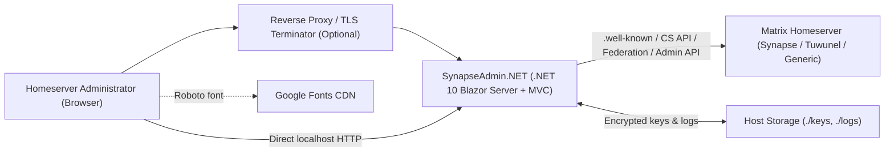
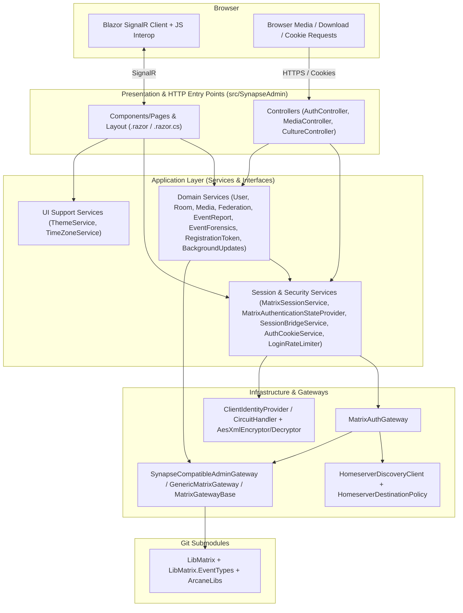
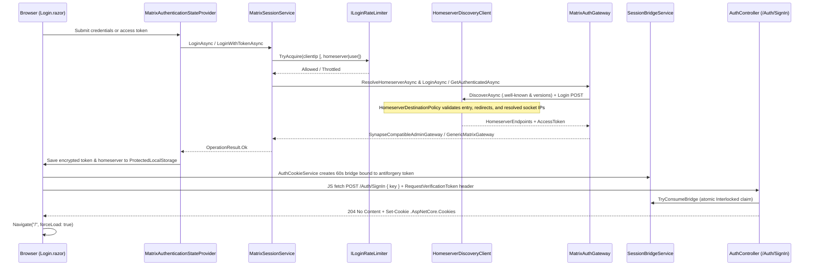
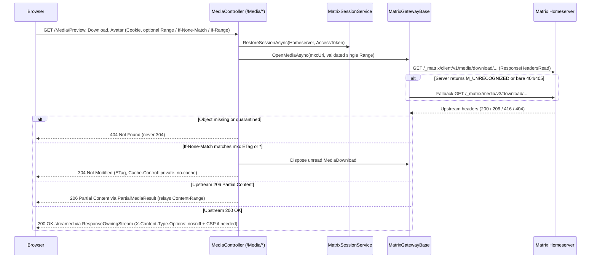

# Architecture

**Last updated:** 2026-11-13
**Maintainer(s):** Benjamin Aicheler

## 1. Context

- **Business purpose:** SynapseAdmin.NET is a self-hosted, browser-based administration console for Matrix homeservers—targeting Synapse and Synapse-Admin-API-compatible servers (such as Tuwunel >= 1.8.1). It replaces manual CLI/SQL administration and provides homeserver operators with a unified UI for user lifecycle management, room & media auditing, content moderation (quarantine, protection, history purging, event reports, unredacted event forensics), registration tokens, federation monitoring, server notices, and database background updates.
- **Users / actors:**
  - **Homeserver Administrator:** Authenticates using Matrix username/password credentials or an existing Matrix access token over HTTPS (or localhost HTTP) to inspect and administer a target homeserver. The application is intended strictly for homeserver administrators rather than general Matrix end users.
  - **Reverse Proxy / TLS Terminator (optional infrastructure actor):** Terminates TLS for remote/LAN deployments and forwards `X-Forwarded-For` and `X-Forwarded-Proto` headers so `Secure` authentication cookies and per-IP login rate limiting function correctly.
- **External systems:**
  - **Target Matrix Homeserver (Synapse, Tuwunel >= 1.8.1, or generic Matrix server):** Source of truth for all Matrix state, authentication, media, and administration operations via `/.well-known/matrix/*`, `/_matrix/client/*`, `/_matrix/federation/v1/version`, and `/_synapse/admin/*`.
  - **Google Fonts CDN (`fonts.googleapis.com`):** Delivers the `Roboto` web font referenced in `src/SynapseAdmin/Components/App.razor`.
  - **GitHub / GHCR (CI/CD & distribution only):** Hosts source, CI workflows, Dependabot, and signed container images (`ghcr.io/benjamin-aicheler/synapseadmin.net`).

## 2. Quality Goals & Constraints

| Priority | Quality goal | Description / target |
|---|---|---|
| 1 | Security & SSRF Isolation | Enforce HTTPS and block private/internal IP targets by default (`IHomeserverDestinationPolicy` + `HOMESERVER_ALLOWLIST`); encrypt Data Protection keys at rest with AES-256-GCM (`DP_PASSPHRASE`); bind session cookie handoff to the initiating browser without URL tokens; sanitize logs and localize safe error messages; run container as non-root `app` (`UID 1654`). |
| 2 | Protocol Compatibility & SDK Isolation | Support Synapse, Tuwunel >= 1.8.1, and generic Matrix fallback via `IMatrixGateway` / `SynapseCompatibleAdminGateway` without modifying the `LibMatrix` / `ArcaneLibs` git submodules; tolerate upstream JSON/timestamp/field quirks. |
| 3 | Architectural Cleanliness & Testability | Enforce N-Tier separation (UI -> Services -> Gateways), interface extraction (`Interfaces/`) for every service/gateway, ViewModel isolation, and automated coverage via xUnit, bUnit, and `WebApplicationFactory`. |
| 4 | Streaming & UI Responsiveness | Stream media downloads/previews directly without full-body buffering (`ResponseOwningStream`), relay HTTP byte ranges (`206`/`416`), validate existence before `304`, paginate large tables server-side, and propagate `CancellationToken` cleanly. |
| 5 | Operational Simplicity | Zero local database requirement (stateless relative to Matrix domain data); single-container deployment with file-backed keys/logs. No fixed SLA, uptime, or concurrency targets are mandated by the project. |

**Constraints:**

- **Runtime & UI stack:** .NET 10 (`net10.0`), Blazor Server (`InteractiveServerRenderMode` with `prerender: false`), MudBlazor 9.12.0, Serilog 10.0.0.
- **Git submodule boundary:** `LibMatrix` and `ArcaneLibs` are included as git submodules (`LibMatrix/` on branch `SynapseAdmin.NET`) and must not be modified locally for Synapse Admin workarounds.
- **Licensing (AGPL-3.0):** The application and its `LibMatrix` / `ArcaneLibs` dependencies are licensed under AGPL-3.0, requiring remote network interaction source disclosure (`LICENSE`, `README.md`, `About.razor`).
- **HTTPS / Secure cookie policy:** Authentication cookies enforce `CookieSecurePolicy.Always`. Local loopback HTTP works directly; remote/LAN access requires a TLS-terminating reverse proxy.
- **Stateful SignalR circuits & process-local caching:** Blazor Interactive Server maintains per-session SignalR circuits, and built-in caches/rate-limit stores use `IMemoryCache`. Multi-replica deployments require sticky sessions and shared `/app/keys` (plus an optional distributed `ILoginRateLimitStore`).
- **No dedicated database / operator-managed compliance:** No local relational or document DB is used; all Matrix data remains on the target homeserver, while only encrypted keys, rolling logs, and in-memory caches live on the host. Hosting, retention, and regulatory/GDPR compliance are at the discretion of each self-hosting administrator.

## 3. Building Blocks / Components

| Component | Location in repo | Responsibility | Depends on |
|---|---|---|---|
| Presentation Pages & Layout | `src/SynapseAdmin/Components/` | Routed Blazor pages (18 `@page` routes + dialogs + `MainLayout`, `NavMenu`, `RoomGalleryGrid`), code-behind `.razor.cs`, JS interop (`wwwroot/js/`), ViewModel binding, and stale-selection cancellation on detail pages. | `Interfaces/`, `Models/ViewModels/`, MudBlazor, `IStringLocalizer` |
| HTTP Controllers | `src/SynapseAdmin/Controllers/` | Cookie bridge sign-in/out (`AuthController`), authorized conditional/ranged media streaming (`MediaController`, `PartialMediaResult`), and culture cookie switching (`CultureController`). | `ISessionBridgeService`, `IMatrixSessionService`, `IMediaService`, ASP.NET Core MVC/Antiforgery |
| Domain Services | `src/SynapseAdmin/Services/` & `Interfaces/` | Business logic, Matrix orchestration, ViewModel mapping (`Extensions/Mapping/`), caching room names/active purges (`RoomService`), media deduplication, and `OperationResult` error wrapping. | `IMatrixSessionService`, `IMatrixGateway`, `IMemoryCache`, `ILogger<T>`, `IStringLocalizer` |
| Session, Auth & Rate Limiting | `src/SynapseAdmin/Services/` & `Interfaces/` | Blazor `AuthenticationStateProvider` (`ProtectedLocalStorage`), session lifecycle (`MatrixSessionService`), browser-bound bridge (`SessionBridgeService`, `AuthCookieService`), and dual-key login throttling (`LoginRateLimiter`, `MemoryLoginRateLimitStore`). | `IMatrixAuthGateway`, `IClientIdentityProvider`, `AntiforgeryStateProvider`, `IMemoryCache` |
| UI Support Services & Themes | `src/SynapseAdmin/Services/` & `Infrastructure/Themes/` | Reflection-discovered themes (`IAppTheme` + 12 themes), persisted light/dark mode (`ThemeService`), and browser IANA timezone conversion (`TimeZoneService`). | `ProtectedLocalStorage`, `IJSRuntime` |
| Gateway & Discovery Layer | `src/SynapseAdmin/Infrastructure/Gateways/` & `Interfaces/Gateways/` | Policy-enforced `.well-known` discovery & password login (`HomeserverDiscoveryClient`), gateway factory & caching (`MatrixAuthGateway`), Synapse/Tuwunel HTTP & JSON handling (`SynapseCompatibleAdminGateway`, `JsonStringConverter`), media stream ownership (`ResponseOwningStream`), and generic fallback (`GenericMatrixGateway`). | `LibMatrix`, `IHomeserverDestinationPolicy`, `IMemoryCache` |
| Security & Data Protection | `src/SynapseAdmin/Infrastructure/Security/` & `DataProtection/` | SSRF/cleartext destination policy (`HomeserverDestinationPolicy`), SignalR circuit IP capture (`ClientIdentityCircuitHandler`, `ClientIdentityProvider`), and AES-256-GCM key ring encryption (`AesXmlEncryptor`, `AesXmlDecryptor`). | ASP.NET Core DataProtection, `IConfiguration`, `IHttpContextAccessor` |
| Matrix SDK Submodules | `LibMatrix/` | Underlying Matrix client models, `AuthenticatedHomeserver*`, `MatrixHttpClient`, and `MxcUri` utilities. | `ArcaneLibs` |
| Test Suite | `tests/SynapseAdmin.Tests/` | xUnit unit tests, bUnit component tests (`Components/` with `DetailPageTestBase` and `Stub`), and `WebApplicationFactory` integration tests. | `SynapseAdmin`, xUnit, bUnit, `Microsoft.AspNetCore.Mvc.Testing` |

### Layering & dependency rules

- **Presentation -> Interfaces & ViewModels only:** `.razor` and `.razor.cs` files must use the code-behind pattern (no inline `@code` blocks), bind only to `Models/ViewModels/`, and check server capabilities via `IMatrixGateway.SupportsAdminApi` rather than concrete gateway type checks.
- **Services -> Gateways via Interfaces:** Every service has an `I*Service` interface in `Interfaces/` and interacts with Matrix exclusively through `IMatrixAuthGateway` / `IMatrixGateway`. All service methods return `OperationResult` or `OperationResult<T>`, catching `OperationCanceledException` silently (`Severity.Normal`) and returning localized user-safe messages on failure.
- **Gateways encapsulate wire & SDK concerns:** Gateways own HTTP calls, URI encoding, JSON type coercion (`SynapseCompatibilityJsonOptions`), and response disposal (`ResponseOwningStream`), never exposing raw `HttpResponseMessage` or raw `LibMatrix` objects to the UI.
- **Submodule isolation:** `LibMatrix/` and `ArcaneLibs/` are treated as immutable upstream dependencies; missing Synapse Admin endpoints or server quirks are implemented in `SynapseCompatibleAdminGateway` and `Models/`.

## 4. Data

- **Main entities:**
  - *Matrix Administration DTOs & ViewModels (transient):* Users, user memberships, user media uploads & totals, rooms, room state/members/messages/media, room directory entries, event reports, raw Matrix events (forensics), registration tokens, federation destinations, background update jobs, and server notices.
  - *Session identity:* `UserId`, `Username`, `Homeserver`, and `AccessToken` stored as ASP.NET Core authentication claims and encrypted `ProtectedLocalStorage` entries.
- **Storage:**
  - **Application database:** None. The target Matrix homeserver persists all domain state.
  - **Host filesystem (mounted volumes `./keys` and `./logs`):**
    - `/app/keys`: ASP.NET Core Data Protection XML key ring, encrypted at rest using PBKDF2-SHA256 (100,000 iterations) + AES-256-GCM derived from `DP_PASSPHRASE` (or unencrypted with a startup warning if `DP_PASSPHRASE` is unset).
    - `/app/logs`: Serilog daily rolling JSON logs (`logs/log-.txt`), retaining up to 7 files by default (`appsettings.json`).
  - **Browser storage & cookies:**
    - `ProtectedLocalStorage`: Data-Protection-encrypted `matrix_homeserver`, `matrix_access_token`, `app_theme_id`, `app_dark_mode`.
    - Cookies: `.AspNetCore.Cookies` (encrypted auth claims, 1-day expiration, `HttpOnly`, `Secure`, `SameSite=Lax`), ASP.NET Core antiforgery cookie, and `.AspNetCore.Culture` (`Secure`, 1-year expiration).
  - **In-process `IMemoryCache`:**
    - Homeserver discovery endpoints (`matrix_discovery:*`, 10 min TTL).
    - Authenticated `IMatrixGateway` instances (`matrix_gateway:*`, 15 min sliding / 1 h absolute TTL; concurrent creations coalesced per key).
    - Session bridge entries (`session_bridge:*`, 60 s TTL, single-use).
    - Login rate-limit buckets (`login_ratelimit:*`, 1 min fixed window).
    - Room name lookups (`room_name:*`, 30 min sliding / 2 h absolute TTL) and active room history purge IDs (`active_purge:*`, 24 h TTL) in `RoomService`.
- **Data ownership:** The target Matrix homeserver is the sole source of truth for all Matrix entities and permissions. `SynapseAdmin.NET` owns only local operational logs, Data Protection key material, and ephemeral session/UI caches.
- **Personal data (PII):** Matrix user IDs, display names, event/message payloads, media metadata, client IP addresses (for rate limiting and audit logs), and access tokens transit the server. Passwords are never persisted (forwarded only during `m.login.password`). Untrusted strings are sanitized via `.SanitizeForLogging()` before logging. Log retention beyond the 7-day rolling log default and GDPR governance are left to the deploying administrator.

## 5. Key Flows

### Flow: Login, SSRF-Checked Discovery & Browser-Bound Cookie Bridge

*(Note: If a returning browser loads a Blazor circuit from `ProtectedLocalStorage` without an active HTTP auth cookie, `NavMenu.CheckSessionSync` triggers the same `AuthCookieService` bridge automatically, provided the origin is HTTPS or loopback.)*

### Flow: Authorized Media Streaming, Conditional Caching & Range Forwarding

### Flow: Homeserver Capability Probing & Stale-Selection Guard on Detail Pages

1. **Capability detection:** During `MatrixAuthGateway.CreateAuthenticatedGatewayAsync`, the gateway initializes `AuthenticatedHomeserverSynapse` or `AuthenticatedHomeserverGeneric`, queries `/_matrix/federation/v1/version` (identifying `Synapse` or `Tuwunel >= 1.8.1`), and actively probes `/_synapse/admin/v1/server_version`. Compatible servers receive `SynapseCompatibleAdminGateway` (`SupportsAdminApi = true`); all others receive `GenericMatrixGateway` (`SupportsAdminApi = false`).
2. **Stale-selection protection:** When Blazor reuses a detail page (`RoomDetails`, `UserDetails`) across route parameter changes (e.g., `/rooms/A` -> `/rooms/B`), `OnParametersSetAsync` synchronously cancels the previous selection's `CancellationTokenSource`, clears the displayed model and `_displayed*Id` before the first `await`, discards late responses, and re-verifies the captured target ID after user confirmation before executing destructive actions.

## 6. Interfaces & Integrations

| Interface | Type | Direction | Format / protocol | Docs |
|---|---|---|---|---|
| Blazor Interactive Server UI (`/`, `/login`, `/users*`, `/rooms*`, `/room-directory`, `/media-maintenance`, `/reports`, `/event-forensics`, `/tokens`, `/federation`, `/notices`, `/background-updates`, `/about`) | Blazor / SignalR | In | HTTPS / WebSockets (HTML + SignalR) | `src/SynapseAdmin/Components/` |
| `AuthController` (`/Auth/SignIn`, `/Auth/SignOutAction`) | HTTP MVC | In | POST JSON `{ key }` + Antiforgery header / GET redirect; Cookie auth | `src/SynapseAdmin/Controllers/AuthController.cs` |
| `MediaController` (`/Media/Avatar`, `/Media/Preview`, `/Media/Download`) | HTTP MVC | In | GET binary stream (`200`, `206`, `304`, `401`, `404`, `416`), `Range` / `ETag` | `src/SynapseAdmin/Controllers/MediaController.cs` |
| `CultureController` (`/Culture/Set`) | HTTP MVC | In | GET query params -> `.AspNetCore.Culture` cookie + redirect | `src/SynapseAdmin/Controllers/CultureController.cs` |
| Matrix Discovery & Login (`/.well-known/matrix/client`, `/.well-known/matrix/server`, `/_matrix/client/versions`, `/_matrix/federation/v1/version`, `/_matrix/client/v3/login`) | REST / JSON | Out | HTTPS (or allowlisted HTTP) via `HomeserverDiscoveryClient` | Matrix CS & Server-Server Specs |
| Matrix Media & CS API (`/_matrix/client/v1/media/download/*`, `/_matrix/media/v3/download/*`, public rooms, room aliases) | REST / Stream | Out | HTTPS JSON & binary streams via `MatrixGatewayBase` & `LibMatrix` | Matrix CS Spec |
| Synapse Admin API (`/_synapse/admin/v1/*`, `/_synapse/admin/v2/*`, `/_synapse/admin/v3/users`) | REST / JSON | Out | HTTPS JSON via `SynapseCompatibleAdminGateway` (users, rooms, media, quarantine/protect, purge history, event reports, `fetch_event`, registration tokens, federation, server notices, background updates, statistics, `server_version`) | `synapse-admin-api-2026-04-18.md` |
| Google Fonts (`fonts.googleapis.com`) | HTTP CDN | Out (Browser) | CSS stylesheet (`Roboto`) | `src/SynapseAdmin/Components/App.razor` |

## 7. Deployment & Infrastructure

- **Environments:**
  - **Local development:** `dotnet run --project src/SynapseAdmin/SynapseAdmin.csproj` (`launchSettings.json` profiles on `http://localhost:5235` and `https://localhost:7256` with `ASPNETCORE_ENVIRONMENT=Development`) or VS Code DevContainer (`.devcontainer/devcontainer.json` with .NET 10, Node 24, `gh` CLI).
  - **Containerized / Production:** Docker multi-stage build (`src/SynapseAdmin/Dockerfile`, `mcr.microsoft.com/dotnet/sdk:10.0` -> `mcr.microsoft.com/dotnet/aspnet:10.0`), executed via `docker-compose.yml` (GHCR image) or `docker-compose.build.yml` (local build) on port `8080`.
- **Hosting:** Self-hosted Docker container (or local .NET process) running as non-root `app` user (`UID 1654`), typically bound to `127.0.0.1:8080:8080` behind a TLS-terminating reverse proxy (Nginx, Caddy, Traefik, etc.), according to the administrator's infrastructure setup. Multi-replica setups require sticky sessions, shared `/app/keys` with matching `DP_PASSPHRASE`, and optionally a distributed `ILoginRateLimitStore` (`README.md`).
- **CI/CD pipeline:**
  - `.github/workflows/dotnet.yml`: Recursive submodule checkout, `dotnet restore`, `dotnet build`, and `dotnet test` on `main` pushes and PRs.
  - `.github/workflows/docker-image.yml`: Multi-architecture (`linux/amd64`, `linux/arm64`) Docker Buildx build, push to `ghcr.io/benjamin-aicheler/synapseadmin.net` on `main`/tags/releases, and artifact signing with Sigstore `cosign`.
  - `.github/workflows/codeql.yml`: CodeQL security analysis for `actions`, `csharp`, and `javascript-typescript`.
  - `.github/dependabot.yml`: Weekly dependency PRs for NuGet, GitHub Actions, Docker base images, and DevContainers (`LibMatrix` submodule is updated manually).
- **Configuration & secrets management:**
  - `DP_PASSPHRASE`: Environment variable encrypting/decrypting Data Protection keys on disk. Changing it invalidates active cookies and `ProtectedLocalStorage` sessions.
  - `HOMESERVER_ALLOWLIST`: Comma/semicolon-separated allowlist for permitted homeservers, plain-HTTP exceptions (`http://host:port`), and internal CIDR/IP exceptions (fails closed if set with no valid entries).
  - `TRUSTED_PROXIES`: Comma/semicolon-separated proxy IPs or CIDRs for `ForwardedHeadersMiddleware` (`ForwardLimit = 1`); defaults to loopback, RFC 1918, and RFC 4193 ranges.
  - `ASPNETCORE_ENVIRONMENT`, `ASPNETCORE_HTTP_PORTS`, `HTTPS_PORT`, `ASPNETCORE_HTTPS_PORTS`.
- **Monitoring / logging / alerting:**
  - Serilog configured in `appsettings.json` outputs to stdout (`Console` sink for `docker logs`) and rolling daily JSON files (`logs/log-.txt`, 7-day retention), enriched with log context, machine name, and thread ID.
  - No built-in metrics, distributed tracing, or alerting backends are bundled; external log aggregation or monitoring is left to the deploying administrator.

## 8. Cross-cutting Concerns

- **Authentication & authorization:** Blazor Interactive Server auth (`MatrixAuthenticationStateProvider`) restores sessions from encrypted `ProtectedLocalStorage` and syncs with ASP.NET Core Cookie Auth (`.AspNetCore.Cookies`) via the antiforgery-bound `SessionBridgeService` + `AuthController.SignIn`. `Routes.razor` wraps pages in `AuthorizeRouteView` (redirecting unauthenticated users to `/login`), `MediaController` requires `[Authorize]`, admin features check `IMatrixGateway.SupportsAdminApi`, and the upstream homeserver enforces actual admin privileges.
- **Error handling:** Services return `OperationResult` / `OperationResult<T>`. `OperationCanceledException` produces `OperationResult.Cancelled()` (`Severity.Normal`), which UI components suppress to avoid noisy error snackbars during navigation. Technical exceptions and `HomeserverNotAllowedException` messages are logged server-side and replaced with safe, localized strings. Production unhandled exceptions route to `/Error`, and missing/error status codes re-execute `/not-found`.
- **Logging & tracing:** `ILogger<T>` is injected across services, gateways, and controllers; untrusted strings (user IDs, room IDs, MXC URIs, proxy headers, homeserver URLs) pass through `LoggingExtensions.SanitizeForLogging()` to strip control chars/newlines and prevent log forging.
- **Caching:** Process-local `IMemoryCache` caches discovery results, authenticated gateways, session bridges, login rate-limit windows, room names, and active purge IDs. Media responses use `Cache-Control: private, no-cache` with deterministic `mxc://` SHA-256 `ETag`s so deletions/quarantines take effect immediately while saving body transfers on `304`.
- **Internationalisation:** Standard `.NET` `IStringLocalizer<SharedResources>` (`Resources/SharedResources*.resx`) combined with `MudBlazor.Translations` for `en-US` (default), `de-DE`, and `fr-FR`, switched via `CultureController.Set` and RTL-aware in `MainLayout`. Timestamps are converted to the browser's IANA timezone via `ITimeZoneService` (`timezone-interop.js`), never server-local time.
- **Performance:** Non-buffering media streaming (`ResponseOwningStream`), upstream HTTP range forwarding (`206`/`416`), server-side pagination for users/rooms/user-media/event-reports, infinite-scroll `IntersectionObserver` (`gallery-interop.js`) in room galleries, `Task.WhenAll` concurrency for dashboard/detail loading, and prompt cancellation on route switches.

## 9. Architecture Decisions

*(There is currently no `docs/adr/` directory in the repository; the table below summarizes the key architectural decisions directly reflected in the codebase and `AGENTS.md`.)*

| ADR | Decision | Status | Date |
|---|---|---|---|
| 0001 | Isolate `LibMatrix` / `ArcaneLibs` submodules behind `IMatrixGateway` and `SynapseCompatibleAdminGateway` (superseding the former SDK-based `SynapseAdminGateway`, removed in #397) to support Synapse, Tuwunel >= 1.8.1, and API quirks (`JsonStringConverter`) without modifying submodules. | Accepted | 2026 |
| 0002 | Synchronize Blazor Interactive Server sessions with ASP.NET Core MVC auth cookies via a 60s single-use, antiforgery-bound `SessionBridgeService` (`POST /Auth/SignIn`), never passing secrets or bridge keys in URLs. | Accepted | 2026 |
| 0003 | Route all unauthenticated discovery and password login through `HomeserverDiscoveryClient` + `IHomeserverDestinationPolicy` (`HOMESERVER_ALLOWLIST`) with connect-time IP validation (`SocketsHttpHandler.ConnectCallback`), bypassing `LibMatrix`'s unvalidated resolver. | Accepted | 2026 |
| 0004 | Encrypt ASP.NET Core Data Protection keys on disk using PBKDF2-SHA256 + AES-256-GCM (`AesXmlEncryptor`/`AesXmlDecryptor`) keyed by `DP_PASSPHRASE` with no external database. | Accepted | 2026 |
| 0005 | Stream protected media via `MatrixGatewayBase.OpenMediaAsync` (`SendUnhandledAsync` + `ResponseOwningStream`), validating session and media existence before `304` and relaying upstream `206`/`416` byte ranges directly. | Accepted | 2026 |

## 10. Technical Debt & Risks

| Item | Impact | Mitigation / plan |
|---|---|---|
| Post-login `LibMatrix` `HttpClient` lacks connect-time IP re-checking | Unauthenticated discovery/login enforces `SocketsHttpHandler.ConnectCallback`, but post-login requests pass validated `WellKnownUris` to `LibMatrix`'s static `MatrixHttpClient` without socket-level DNS-rebinding checks (`AGENTS.md`). | Entry/delegated URLs are policy-checked prior to login; full post-login enforcement would require injecting a custom `HttpMessageHandler` into `LibMatrix`. |
| In-memory state limits horizontal scaling | `MemoryLoginRateLimitStore`, `SessionBridgeService`, gateway cache, and `RoomService` caches are process-local by default. | Configure sticky sessions and shared `/app/keys` across replicas, and register a distributed `ILoginRateLimitStore` if scaling horizontally (`README.md`). |
| Unconfigured or weak `DP_PASSPHRASE` | Missing `DP_PASSPHRASE` stores Data Protection keys unencrypted on disk; leaving the sample passphrase in `docker-compose.yml` weakens at-rest encryption; rotating it invalidates existing sessions. | Startup logs a warning when unset; document production passphrase generation and rotation impact in `README.md`. |
| Manual git submodule updates | Dependabot cannot update `LibMatrix/` or `ArcaneLibs/` (`.github/dependabot.yml`), risking stale SDK dependencies. | Periodically review and update the `LibMatrix` submodule manually. |
| Coupling to undocumented Synapse / Tuwunel API quirks | Upstream changes to `next_token` types, `creation_ts` units (ms vs s across v3/v2), `avatar` naming, or localpart media-stats filtering could break endpoints. | Isolated inside `SynapseCompatibleAdminGateway` and mapping extensions, covered by serialization, pagination, and deduplication unit tests. |
| External Google Fonts CDN link (`App.razor`) | Browser requests `fonts.googleapis.com` for Roboto; air-gapped or strict-CSP environments will fall back to system fonts or log CSP violations. | Accepted for now (offline/air-gapped environments are not currently targeted); can self-host Roboto CSS/woff2 assets in `wwwroot/` later if needed. |

## 11. Glossary

| Term | Meaning |
|---|---|
| Matrix Homeserver | A federated Matrix server hosting user accounts, rooms, events, and media (e.g., Synapse, Tuwunel). |
| Synapse Admin API | Administrative HTTP endpoints under `/_synapse/admin/*` exposed by Synapse and compatible homeservers (such as Tuwunel >= 1.8.1). |
| CS API (Client-Server API) | Standard Matrix protocol endpoints under `/_matrix/client/*` used for login, public room directory, aliases, and authenticated media downloads. |
| MXC URI | Matrix Content URI (`mxc://<server_name>/<media_id>`) identifying immutable media objects on a Matrix homeserver. |
| `.well-known` Delegation | Matrix mechanism (`/.well-known/matrix/client` and `/server`) mapping a domain name to its actual client-server and federation endpoints. |
| `LibMatrix` / `ArcaneLibs` | AGPL-3.0 Matrix SDK and utility libraries integrated as git submodules. |
| Blazor Circuit | Stateful server-side UI session maintained over SignalR in Blazor Interactive Server mode. |
| Session Bridge | `SessionBridgeService` mechanism exchanging a short-lived, single-use, antiforgery-bound key from a Blazor circuit for an HTTP authentication cookie (`POST /Auth/SignIn`). |
| Quarantine / Protect (Media) | Synapse Admin operations that block serving a media item (`quarantine`) or exempt it from automated cleanup/purging (`protect`). |
| Event Forensics | Inspection of raw, unredacted Matrix event JSON payloads by event ID (`/_synapse/admin/v1/fetch_event/{eventId}`) without room membership. |
| Data Protection Key Ring | ASP.NET Core cryptographic keys persisted in `./keys` (`/app/keys`) used to protect cookies and `ProtectedLocalStorage`. |
